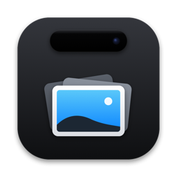
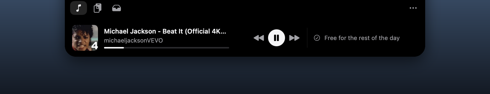

<p align="center">
  
</p>

<h1 align="center">Skerry</h1>

<p align="center">
  <b>The notch, made useful.</b> Screenshots in batches you paste with one click,<br>
  a clipboard that never keeps a password, and your music — one hover away.<br>
  Private by default: no network requests, no open ports.
</p>

<p align="center">
  <a href="LICENSE"></a>
  
  
  <a href="README.ru.md">Русский</a>
</p>

<p align="center">
  
</p>

<!-- More screenshots to come: assets/readme/batch.png, clipboard.png, now.png -->

## Why Skerry

**Screenshots in batches.** Take a few screenshots as usual (⇧⌘3, ⇧⌘4, ⇧⌘5). They collect into one batch at the notch, and **Paste into Claude · 3** drops the whole batch into the app you were working in. You can pick which shots go, drag the batch anywhere, mark a shot up, or AirDrop it. Optionally, shots taken straight to the clipboard (⌃⇧⌘3/4) join the batch too. They live in a temporary folder and are gone within a day.

**A clipboard history you can trust.**
- Everything you copy shows up as a card, with search, filters and pins.
- Passwords are never recorded, whether they come from password managers (they mark copies as concealed) or from apps you exclude.
- History lives in memory only, unless you turn on saving to disk.
- Entries expire after 24 hours, and one-time codes after 2 minutes.

**Now playing, calm.** Artwork, title and the transport controls are always there. Shuffle, repeat, volume, output and lyrics appear while the pointer is over the player. **Next** shows your upcoming events beside it. **Auto** picks between Spotify, Music and anything playing in a browser. Swipe the closed notch to change tracks.

**Small things done right.**
- **Keep Awake** with a timer.
- **A shelf** for files you drop on the notch.
- **A colour picker** that copies the colour and flashes it at the notch, without stealing focus.
- **Compact layout**: the player in one row.
- **Hotkeys**.
- **English and Russian**.
- While your screen is shared or recorded, the clipboard and screenshots show only their titles, and the notch keeps quiet.

## Privacy

By default Skerry **sends nothing over the network and listens on no port**.

Every network address in the source is listed in [`tests/network_allowlist.txt`](tests/network_allowlist.txt), together with the feature and the setting that turns it on. A test fails if a new address appears without an entry.

| Opt-in feature | What leaves your Mac, and where |
|---|---|
| Lock screen weather | approximate location → wttr.in or open-meteo.com |
| Lyrics | track title and artist → lrclib.net, music.163.com (asks before turning on) |
| "Explicit" badges, artist names | track title → itunes.apple.com, open.spotify.com |
| Apple Music animated artwork | request to api.music.apple.com |
| Spotify like and Canvas | your Spotify sign-in, api.spotify.com |
| Screen Assistant | **screenshots and text** → the AI service you pick, or local Ollama |
| AI usage (Claude, Codex, Cursor…) | tokens from your keychain → those services |
| Third-party extensions, LocalSend, Quick Share | a local port on this Mac / your local network |

Software updates (Sparkle) are switched off. The camera "mirror" has no camera entitlement.

## Install

1. Download `Skerry-<version>.dmg` from [Releases](../../releases) and drag **Skerry** to Applications.
2. Skerry is free and not notarized: the developer has no paid Apple account. macOS will block the first launch. Open **System Settings → Privacy & Security** and click **Open Anyway** next to Skerry.
3. Allow **Accessibility** when asked. It lets Skerry paste into other apps in one click.

Each release is signed ad hoc, so macOS treats every update as a new app. After updating, switch Accessibility for Skerry off and on again. Building from source with your own Apple ID avoids this (see below).

To check a download, compare it with the `.sha256` file next to it: `shasum -a 256 -c Skerry-<version>.dmg.sha256`.

## Build from source

You need macOS 15 or later and a recent Xcode (Swift 6.1 or later).

```bash
git clone https://github.com/amidamaru940/skerry.git
cd skerry
open DynamicIsland.xcodeproj   # scheme "DynamicIsland", press Run
```

By default the app is signed to run on your Mac only. To sign it with your own (free) Apple ID team, so that macOS keeps permissions across rebuilds, create `Config/Local.xcconfig` (git ignores it):

```
DEVELOPMENT_TEAM = ABCDE12345
CODE_SIGN_IDENTITY = Apple Development
```

- **Release DMG:** `scripts/make-release.sh` builds it with Xcode and macOS tools only.
- **Tests:** `xcodebuild test -scheme DynamicIsland -destination 'platform=macOS'` and `python3 -m unittest discover tests`. The tests make no network requests and never touch your real settings.

## Credits

Skerry is a fork of [**Atoll**](https://github.com/Ebullioscopic/Atoll) by Ebullioscopic and contributors, which builds on [**boring.notch**](https://github.com/TheBoredTeam/boring.notch). Thank you for the foundation.

Skerry is independent and is not affiliated with Apple, the Atoll project or Mercedes-AMG. See [NOTICE](NOTICE) and [TRADEMARKS](TRADEMARKS).

## License

[GNU General Public License v3.0](LICENSE), like Atoll and boring.notch.
